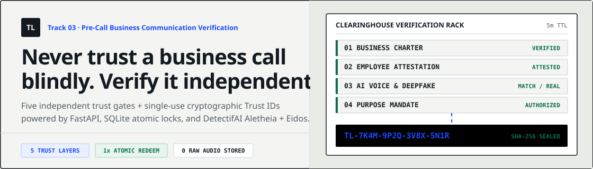
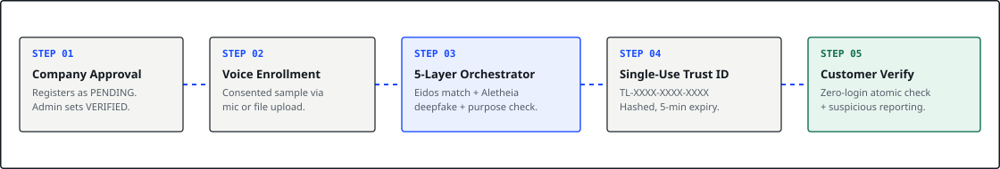
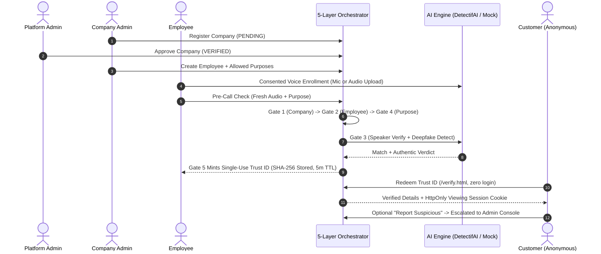
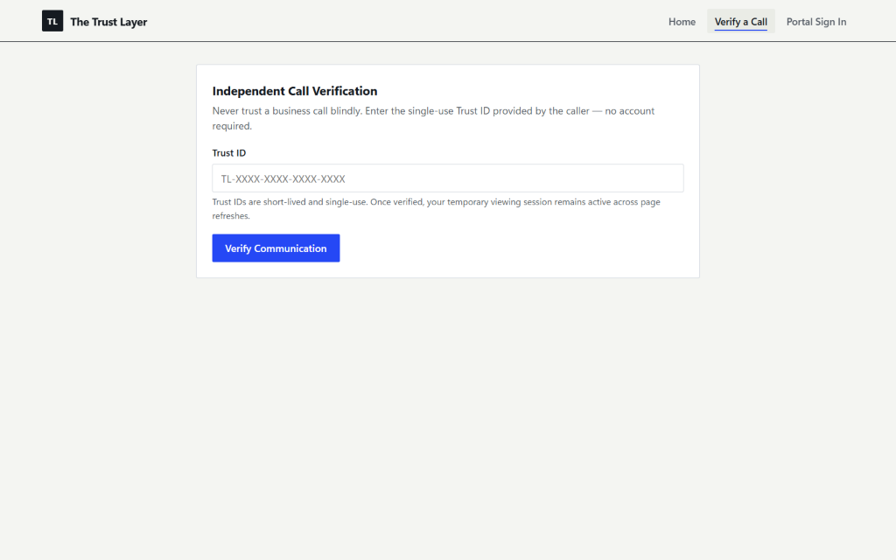
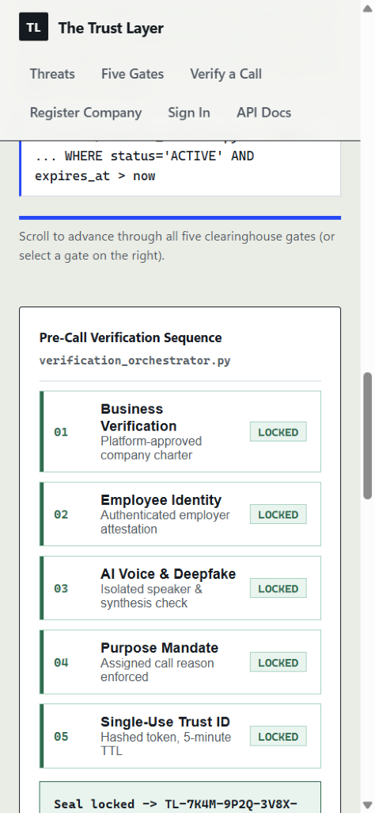
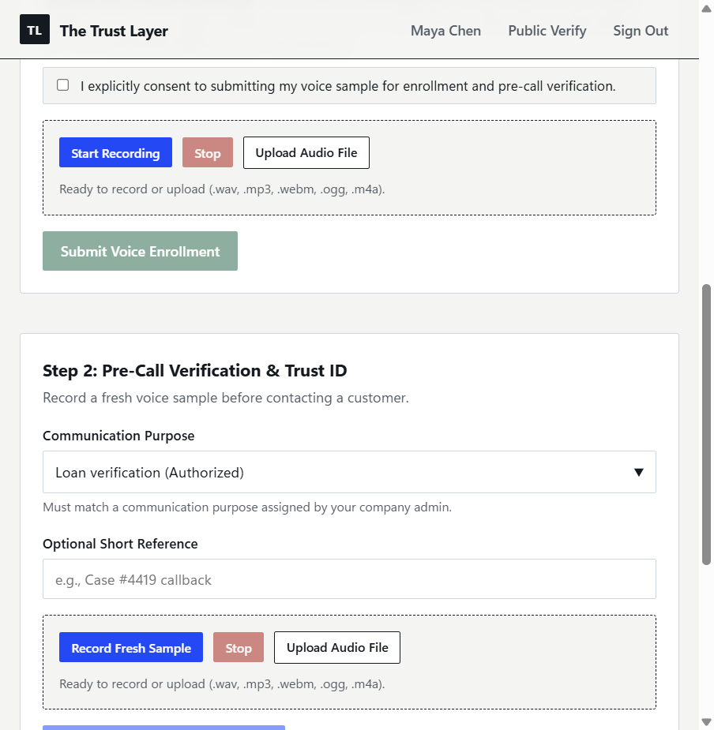
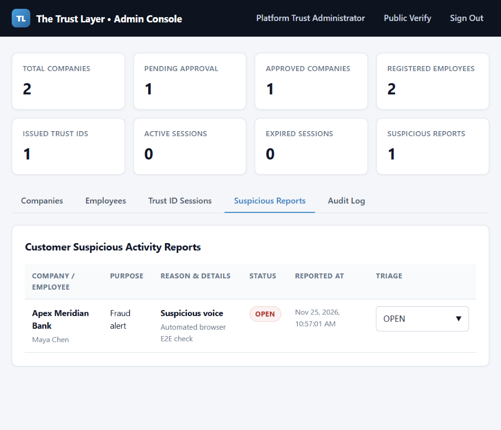
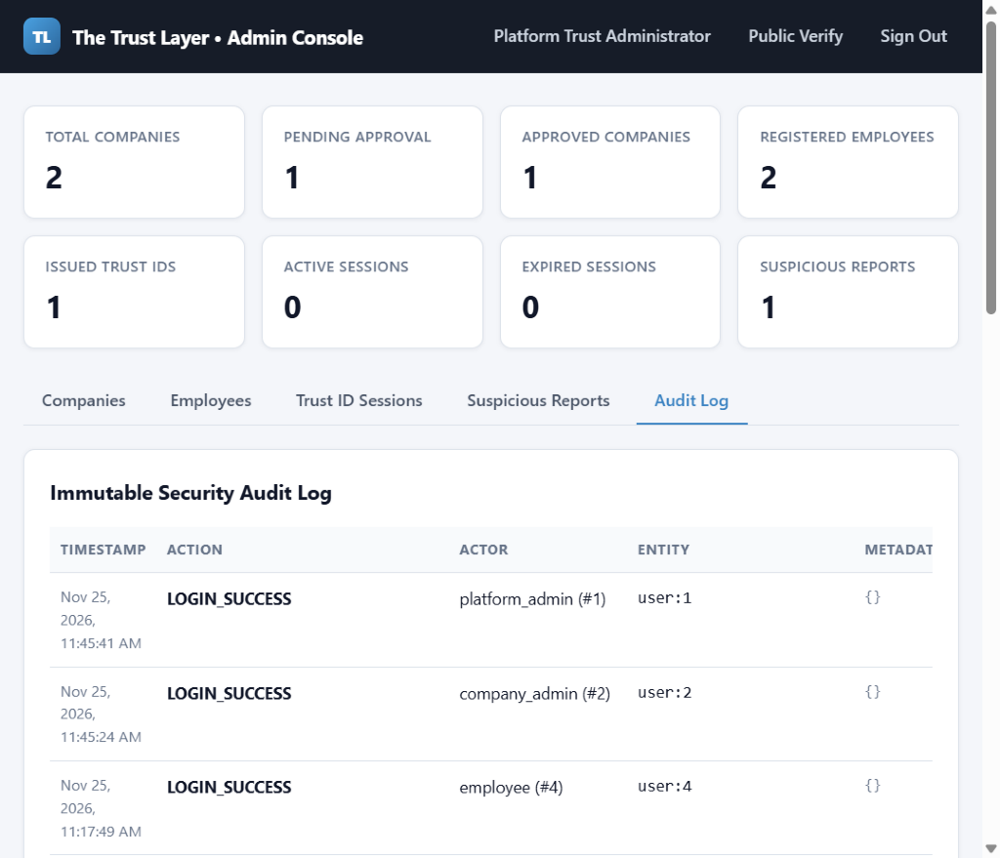

<div align="center">



<br />

[](backend/requirements.txt)
[](backend/app/main.py)
[](backend/app/db/models.py)
[](backend/app/trust_engine/detectifai_provider.py)
[](tests/)

<p>
  <a href="#how-it-works">How It Works</a> ·
  <a href="#five-independent-trust-layers">Five Trust Layers</a> ·
  <a href="#quick-start">Quick Start</a> ·
  <a href="#interactive-api-reference">API Reference</a> ·
  <a href="#verified-screenshots">Screenshots</a> ·
  <a href="#mvp-transparency--limitations">Limitations</a>
</p>

</div>

---

## Why The Trust Layer Exists

Caller ID spoofing and AI voice cloning make inbound phone calls impossible to trust on voice or phone number alone. **The Trust Layer** gives verified institutions an independent out-of-band verification seal:

1. An employee proves authorization and submits a live or uploaded voice sample **before** contacting a customer.
2. Five independent backend trust gates evaluate company legitimacy, employee attestation, AI voice/deepfake signals, and purpose authority.
3. Only if **all five gates lock** does the system mint a short-lived, single-use **Trust ID** (`TL-XXXX-XXXX-XXXX-XXXX`), stored as a SHA-256 hash.
4. The customer visits `/verify.html` with **zero account required**, redeems the Trust ID atomically once, inspects verified caller metadata, and can flag suspicious sessions straight to platform administrators.

---

## How It Works

<p align="center">
  
</p>



---

## Five Independent Trust Layers

<details open>
<summary><strong>Click to inspect each isolated backend layer and enforcement rule</strong></summary>

| Layer | Module | Responsibility | Failure Behavior |
| :--- | :--- | :--- | :--- |
| **01 · Business Verification** | [`business_verification.py`](backend/app/services/business_verification.py) | Confirms company exists and holds `VERIFIED` status | Denies Trust ID if `PENDING`, `REJECTED`, or `SUSPENDED` (`403`) |
| **02 · Employee Identity** | [`employee_verification.py`](backend/app/services/employee_verification.py) | Validates active employee account, company match, `COMPANY_ATTESTED` status, and enrolled voice | Blocks inactive, mismatched, or unenrolled callers (`403`) |
| **03 · AI Voice & Deepfake** | [`trust_engine/`](backend/app/trust_engine/ai_provider.py) | Runs speaker verification + deepfake detection via `DetectifAIProvider` or `MockAIProvider` | Blocks Trust ID on mismatch, suspected deepfake, or API error (`403` / `503`) |
| **04 · Purpose Authority** | [`permission_verification.py`](backend/app/services/permission_verification.py) | Checks requested purpose against employee's `allowed_purposes` | Rejects arbitrary or unassigned communication purposes (`403`) |
| **05 · Session Validity** | [`session_service.py`](backend/app/services/session_service.py) | Mints hashed Trust IDs, enforces UTC expiry, executes atomic single-use SQLite `UPDATE`, manages `HttpOnly` customer cookies | Rejects replays (`409`), expired (`410`), or revoked (`400`) tokens |

</details>

---

## Quick Start

### 1. Clone, create virtual environment & install dependencies

```powershell
git clone https://github.com/rounitraj7416/Truvex-1.1.git
cd Truvex-1.1
python -m venv .venv
.\.venv\Scripts\pip.exe install -r backend\requirements.txt
```

### 2. Configure environment variables

```powershell
Copy-Item .env.example .env
```

Edit `.env` to set a strong `SECRET_KEY` and select your AI engine (`mock` for offline demo mode, or `detectifai` with your DetectifAI key).

### 3. Initialize SQLite database & seed demo accounts

```powershell
.\.venv\Scripts\python.exe scripts\seed_demo.py
```

### 4. Start the server

```powershell
.\.venv\Scripts\uvicorn.exe app.main:app --app-dir backend --host 127.0.0.1 --port 8000 --reload
```

Open **`http://127.0.0.1:8000`** (interactive OpenAPI docs at **`http://127.0.0.1:8000/docs`**).

<details>
<summary><strong>Seeded Demo Credentials (created by scripts/seed_demo.py)</strong></summary>

| Role | Email | Password | State |
| :--- | :--- | :--- | :--- |
| **Platform Admin** | `admin@trustlayer.demo` | `AdminTrust!2026ChangeMe` | Active |
| **Company Admin (Verified)** | `security@apexmeridian.example` | `CompanyDemo!2026` | `VERIFIED` (*Apex Meridian Bank*) |
| **Company Admin (Pending)** | `compliance@northstarlending.example` | `CompanyDemo!2026` | `PENDING` (*Northstar Lending Corp*) |
| **Employee (Voice Enrolled)** | `maya.chen@apexmeridian.example` | `EmployeeDemo!2026` | `ENROLLED` (Mock seed) |
| **Employee (Not Enrolled)** | `liam.patel@apexmeridian.example` | `EmployeeDemo!2026` | Voice `PENDING` |

</details>

---

## DetectifAI Aletheia + Eidos vs. Demo Mode

<details>
<summary><strong>Configure live DetectifAI speech verification or offline DEMO MODE</strong></summary>

Set `AI_PROVIDER` in `.env`:

- **`AI_PROVIDER=mock`** *(default offline mode)*: Uses [`MockAIProvider`](backend/app/trust_engine/mock_provider.py) for deterministic per-employee demos and test failure scenarios (`voice_mismatch`, `deepfake_detected`). Every mock response sets `is_mock=True` and surfaces a mandatory `DEMO MODE` notice across logs, DB, API responses, and UI.
- **`AI_PROVIDER=detectifai`**: Uses [`DetectifAIProvider`](backend/app/trust_engine/detectifai_provider.py) against `https://platform.detectif.ai`:
  - `POST /v1/speakers/enroll` (Eidos voiceprint enrollment)
  - `POST /v1/speakers/verify` (Eidos speaker match)
  - `POST /v1/deepfake/detect` (Aletheia deepfake detection)
  - Set `DETECTIFAI_API_BASE_URL=https://platform.detectif.ai` and `DETECTIFAI_API_KEY=dtf_live_...` in `.env`.
  - On [`employee-dashboard.html`](frontend/employee-dashboard.html), employees can either record live via `MediaRecorder` **or** upload local audio files (`.wav`, `.mp3`, `.webm`, `.ogg`, `.m4a`, `.flac`, `.aac`).

</details>

---

## Interactive API Reference

<details>
<summary><strong>Click to expand all FastAPI endpoints across Auth, Companies, Employees, Verification, Public &amp; Admin</strong></summary>

| Group | Method & Path | Role / Access | Purpose |
| :--- | :--- | :--- | :--- |
| **Health** | `GET /api/health` | Public | Server & active AI provider status |
| **Auth** | `POST /api/auth/login` | Public | Argon2id check; issues JWT + `HttpOnly` cookie |
| **Auth** | `POST /api/auth/logout` | Authenticated | Clears auth cookie |
| **Auth** | `GET /api/auth/me` | Authenticated | Current user + company status |
| **Company** | `POST /api/companies/register` | Public | Registers company in `PENDING` status |
| **Company** | `GET /api/companies/me` | `company_admin` / `employee` | Company details & approval audit history |
| **Company** | `GET /api/companies/me/sessions` | `company_admin` | Company-scoped Trust ID sessions |
| **Company** | `POST /api/companies/me/sessions/{id}/revoke` | `company_admin` | Revoke company session |
| **Employees** | `GET / POST /api/employees` | `company_admin` | List or register employees (`VERIFIED` companies only) |
| **Employees** | `PATCH /api/employees/{id}` | `company_admin` | Update purposes, role, or active state |
| **Employees** | `GET /api/employees/me` | `employee` | Profile, allowed purposes & enrollment status |
| **Verification** | `POST /api/verification/voice-enroll` | `employee` | Consented voice enrollment (mic or file upload) |
| **Verification** | `POST /api/verification/pre-call` | `employee` | Runs 5-layer check & issues Trust ID |
| **Public** | `POST /api/public/verify` | Anonymous (Rate-limited) | Atomic single-use Trust ID redemption + cookie |
| **Public** | `GET /api/public/session` | Anonymous Cookie | Refresh-safe customer verification view |
| **Public** | `POST /api/public/report-suspicious` | Anonymous Cookie (Rate-limited) | Persist suspicious report & escalate to admins |
| **Admin** | `GET /api/admin/stats` | `platform_admin` | Live platform metrics from SQLite |
| **Admin** | `POST /api/admin/companies/{id}/approve\|reject\|suspend\|reactivate` | `platform_admin` | Company governance lifecycle |
| **Admin** | `GET / PATCH /api/admin/reports` | `platform_admin` | View & triage suspicious reports |
| **Admin** | `GET /api/admin/audit-logs` | `platform_admin` | Immutable security audit log |

</details>

---

## Security & Data Integrity Controls

<details>
<summary><strong>Click to inspect security safeguards and test coverage (19/19 Pytest Passing)</strong></summary>

1. **Argon2id Password Hashing** (`argon2-cffi`) and PyJWT `HS256` tokens in `HttpOnly` cookies.
2. **Cryptographic Trust IDs**: High-entropy `TL-XXXX-XXXX-XXXX-XXXX` codes stored exclusively as SHA-256 digests.
3. **Atomic Single-Use Redemption**: Conditional SQLite `UPDATE ... WHERE status='ACTIVE' AND revoked_at IS NULL AND expires_at > :now` runs as the first statement in the transaction, verified under multi-threaded concurrent requests (`test_concurrent_redemption_cannot_succeed_twice`).
4. **Strict Tenant Isolation**: `company_admin` and `employee` routes enforce `company_id` ownership server-side.
5. **Safe Media Handling**: Audio uploads validate MIME type and 10 MB size cap in memory; raw audio is never persisted in SQLite or disk.
6. **Public Rate Limiting & Privacy**: Sliding-window rate limiter (`429`) on `/api/public/verify` and `/api/public/report-suspicious`; public responses strip internal IDs, emails, and employee codes.

Run the test suite:

```powershell
.\.venv\Scripts\pytest.exe -v
```

</details>

---

## Verified Screenshots

<details>
<summary><strong>View captured desktop &amp; mobile screenshots across verification flows</strong></summary>

| Screen | Preview |
| :--- | :--- |
| **Public Verification (`/verify.html`)** |  |
| **Five-Gate Clearinghouse Mobile (`390x844`)** |  |
| **Employee Dashboard (`DetectifAI` + Audio Upload)** |  |
| **Platform Admin Console — Suspicious Reports** |  |
| **Platform Admin Console — Immutable Audit Log** |  |

</details>

---

## MVP Transparency & Limitations

- **No Live PSTN / Cellular Audio Interception:** The Trust Layer is a pre-call authorization and out-of-band verification platform; it does not tap carrier audio streams or cryptographically bind an external cellular call's audio channel.
- **Platform-Admin Company Approval:** Company verification reflects platform administrator review in this MVP, not automated government corporate registry lookups.
- **Company-Attested Employee Identity:** Employee identity reflects employer-issued credentials and attestation unless an external KYC provider is integrated.
- **Mock vs. Live AI:** When `AI_PROVIDER=mock`, scores are deterministic simulations (`DEMO MODE`); when `AI_PROVIDER=detectifai`, real audio clips are evaluated by `platform.detectif.ai`.
